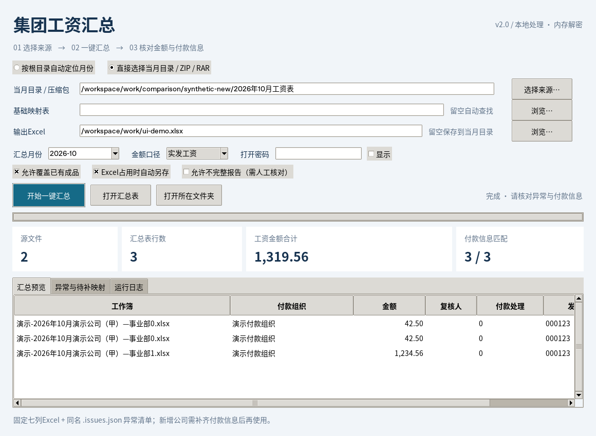

# 集团工资汇总 v2.0

本地桌面工具：读取多个加密工资Excel，每个非“明细”工作表生成一行，提取实发/应发合计，匹配付款信息，生成固定七列集团汇总。

本版已对照用户提供的 **v1.0原EXE** 补齐操作和业务差异，附[详细对照说明](docs/COMPARISON.md)。



## Windows直接使用（无需Python）

前往 [v2.0下载页面](https://github.com/ZY-2012/tmp_project/releases/tag/v2.0)，下载 `SalaryConsolidator-v2.0-Windows.zip`，解压后双击 `SalaryConsolidator-v2.0.exe`。

1. 选择“按根目录自动定位月份”，选包含各月份工资文件夹的根目录；或选择“直接选择当月目录 / ZIP / RAR”。
2. 选月份。基础映射表与输出位置可留空，工具会自动查找映射并将成品保存到当月目录。
3. 输入工资表打开密码，选择实发或应发口径，点击“开始一键汇总”。
4. 查看统计卡片、汇总预览和异常列表。新增公司、容错匹配的付款信息应人工复核。
5. 点击“打开汇总表”或“打开所在文件夹”。同目录 `.issues.json` 保留诊断统计。

密码不会写入路径偏好，处理结束后清空；不内置真实密码。路径、月份和金额口径可自动记忆。运行工具无需联网，工资表解密仅在内存进行。首次源码安装需联网下载依赖。

## 源码运行

Python 3.10+，需包含Tkinter。Windows也可双击 `启动工具.bat` 创建环境并启动。

```sh
python -m venv .venv
# Windows: .venv\Scripts\activate
# macOS/Linux: source .venv/bin/activate
python -m pip install -r requirements.txt
python app.py
```

Linux需系统 `python3-tk`，建议安装Noto CJK字体；macOS使用含Tk的Python发行版。源码按Python版本选择兼容的解密库版本。

## 命令行

密码可通过环境变量 `SALARY_XLSX_PASSWORD` 或本地 `~/.workbuddy/salary-consolidation/config.json` 的 `password` 字段提供。未加密文件无需密码。

```sh
python aggregate.py --month 2026-10 --base-dir "月度工资根目录"
python aggregate.py --month 202610 --input "当月工资目录" --mapping "基础信息映射表格.xls"
python aggregate.py --month 2026年10月 --input "工资包.rar" --output "集团工资汇总_2026-10.xlsx"
```

参数：`--amount-field 应发工资`、`--overwrite`、`--on-locked timestamp`、`--allow-partial`。默认实发工资、不覆盖旧成品，读取失败/金额缺失时阻止输出并返回非零退出码；可明确允许生成带醒目标记的不完整报告。无映射或未匹配映射会留空并提示。

月份支持 `YYYY-MM`、`YYYY年M月`、`YYYYMM`。自动定位支持 `YYYY年M月工资表`、类似月份目录及根目录直接存放源表。递归子目录；若已有源xlsx则忽略压缩包，避免同批数据重复。月份用于定位和命名，不会按文件名过滤，输入应只含当月资料。

## 汇总规则

- 工作表名包含“明细”的排除，其余逐表汇总；前15行按关键字评分定位表头。
- 去空白及括号内容，金额列精确优先、包含次之；取首单元格含“合计/总计”的最后一行，无标记时回退最后非空行并提示。
- 使用Excel公式缓存，不重新计算公式；金额缺失时需在Excel计算保存后重跑。
- 映射支持xls/xlsx，前15行查“工作簿”表头，重复键取首条。严格文件名包含优先，之后做括号/横线/空白/扩展名归一化，最长命中优先。
- 归一化可能让新增项目复用公司映射，工具会标记提示，请核对付款组织与账号。
- 保留字段0和文本账号前导零。原表若以数字存储账号而丢失前导零，无法自动恢复。
- 排除旧 `集团工资汇总*`、`~$*`、基础映射、指定输出；禁止输出覆盖源文件或映射。
- 单sheet“报告”：B2统计，B4:H4为工作簿/付款组织/金额/复核人/付款处理/发放账号/出纳，第5行起数据，末行合计。
- 十进制累计、原子保存、冻结窗格、筛选和金额格式；异常另存JSON，不改变固定七列布局。

## RAR与ZIP

ZIP使用标准库（加密ZIP仅支持其支持的传统加密格式）。RAR需要 **UnRAR、WinRAR附带UnRAR、7-Zip、unar或支持RAR的bsdtar**；自动检测WinRAR/7-Zip默认安装目录及Windows系统tar。加密包尝试使用输入的同一密码，后端不支持时请先手动解压。GNU tar不支持RAR。

压缩包在临时目录展开，处理后清理；拒绝路径穿越和链接，限制展开2GiB/10000项。不要将工资数据、映射、密码配置或诊断清单提交到公开仓库。

## 测试及Windows构建

```sh
python -m pip install pytest
python -m pytest -q
```

当前34项测试；无显示的Linux跳过1项桌面测试，Windows构建执行完整集。已验证实际加密样本与原引擎七列结果一致、生成边界表一致、真实RAR解压，以及本地桌面后台汇总。尚无整月120份数据，未宣称整月基准通过。

GitHub Actions → **Windows EXE Release** → **Run workflow** 可重新构建。流水线执行测试、PyInstaller打包、实际启动EXE验证窗口、计算校验值，然后上传v2.0发布资产。自行打包：

```sh
python -m pip install pyinstaller==6.20.0
python -m PyInstaller --noconfirm --clean --onefile --windowed --name SalaryConsolidator-v2.0 --collect-all msoffcrypto app.py
```


## 后续功能迭代用 Skill

已整理本项目专用的 [salary-consolidation-maintenance 技能](.agents/skills/salary-consolidation-maintenance/SKILL.md)，涵盖业务规则、开发定位、原版对照、验证矩阵、Windows发布和变更记录模板。

- 本仓库已放在 `.agents/skills/salary-consolidation-maintenance/`；支持该目录发现规则的Codex环境可在重新打开项目或刷新技能后使用。
- 也可下载 [独立技能ZIP](https://github.com/ZY-2012/tmp_project/releases/download/v2.0/salary-consolidation-maintenance-skill.zip)，把整个文件夹放到其他项目的 `.agents/skills/` 下。其他AI可直接读取其中的SKILL.md及references；这不等于已向所有客户端自动安装技能。
- 技能仅包含维护知识、参考文件和打包脚本，不含工资样本、映射、密码、原工具或应用EXE。应用历史基线为v2.0，后续以实际源码与发布记录为准。

后续可这样提需求：

> 使用 salary-consolidation-maintenance，新增按出纳筛选预览，Excel输出保持七列。完成测试后提交GitHub并发布新版本。

技能结构检查与独立打包（仓库根目录）：

```sh
python .agents/skills/salary-consolidation-maintenance/scripts/package_skill.py
python .agents/skills/salary-consolidation-maintenance/scripts/package_skill.py --output /临时目录/salary-consolidation-maintenance-skill.zip
```

也可在GitHub Actions运行 **Package Maintenance Skill**，仅打包技能并附加到指定已有Release；后续修订应使用新的包名，流程不会覆盖同名资产。

本次仅新增维护技能与文档，不改变v2.0应用二进制。后续发布应用前请先阅读技能中的发布说明，处理现有流水线硬编码版本与旧资产覆盖问题。
